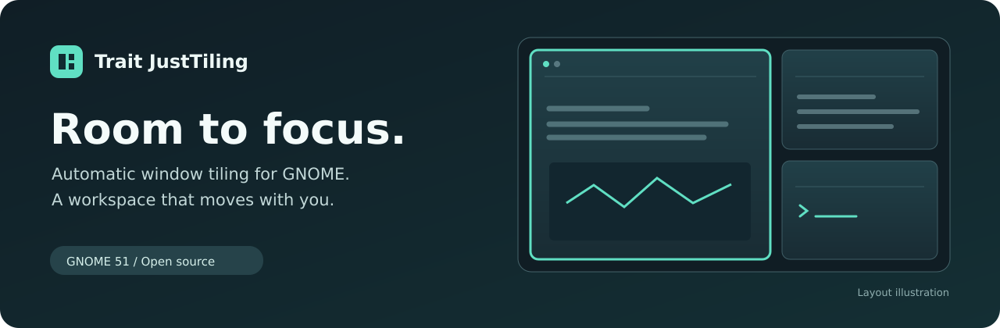

<p align="center">
  
</p>

<p align="center">
  <strong>Keep your windows organized. Keep your attention on your work.</strong><br>
  Automatic tiling, flexible layouts, and a clear focus — built for your GNOME desktop.
</p>

<p align="center">
  <a href="https://trait.li/just">Website</a> ·
  <a href="docs/README.md">Documentation</a> ·
  <a href="https://github.com/traitbrasil/justtiling/issues">Report an issue</a> ·
  <a href="README.pt-BR.md">Português</a>
</p>

---

**GNOME Shell 51** · **Single monitor** · **English & Portuguese** · **GPL-3.0-or-later**

Trait JustTiling arranges your windows as you open and close them, giving each workspace its own layout. Adjust a split, swap two windows, or keep an application floating. Your desktop stays yours to shape.

**Current version: 0.19.3.** Preparation for the first GNOME Extensions submission is underway. Install from source using the steps below.

## Make room for the way you work

| Organize automatically | Shape your workspace | Stay in control |
| --- | --- | --- |
| Open a window and the layout makes room. Close it and the remaining windows reclaim the space. | Resize shared edges, swap by dragging or keyboard, and choose where new windows appear. | Toggle tiling, float an application, and customize every shortcut in Preferences. |

- **A layout for every workspace.** Move between tasks without sharing one layout across all workspaces.
- **Keep your main window comfortable.** Preserve the focused window's size when adding another window, whenever space allows.
- **Remember your adjustments.** Local layout learning uses successful manual resizing and swaps to guide future application positions and sizes.
- **Let floating windows float.** Incompatible windows stay floating. Application exceptions keep tools you choose outside the tiling layout.
- **Preview your swap.** A translucent GNOME-accent overlay marks a compatible destination while you drag.
- **See your focus.** An optional border follows the GNOME accent color.
- **Make it feel right.** Adjust gaps, insertion side, mouse behavior, and shortcuts through native Preferences.

Layout learning is enabled by default. It is a preference, rather than an exact saved grid: available space and window constraints take priority. Pause it or forget individual applications or all learned layouts at any time.

## Get started

You need **GNOME Shell 51**, one logical monitor, and the development tools `git`, `make`, `gjs`, `python3`, and `glib-compile-schemas`.

```bash
git clone https://github.com/traitbrasil/justtiling.git
cd justtiling
make package
gnome-extensions install --force dist/just@trait.com.br.shell-extension.zip
```

**Log out and log back in**, then enable the extension:

```bash
gnome-extensions enable just@trait.com.br
gnome-extensions prefs just@trait.com.br
```

Open a few windows to start tiling. Use the panel menu to change behavior or access Preferences. [Installation and updates →](docs/installation.md)

## Your keyboard, your layout

| Default shortcut | Action |
| --- | --- |
| **Super + T** | Turn automatic tiling on or off |
| **Super + O** | Toggle the active window between tiled and floating |
| **Super + F** | Cycle focus through tiled windows |
| **Super + C** | Swap with a numbered window; Esc or the shortcut again cancels |
| **Super + ← / → / ↑ / ↓** | Swap the active tile with its neighbor |

All eight actions are configurable. The default Super+Arrow shortcuts temporarily replace conflicting GNOME shortcuts while tiling is active, and restore them when management stops. [Shortcuts and behavior →](docs/user-guide.md)

## Built for a focused setup

This version supports **one logical monitor on GNOME Shell 51**. Connecting a second monitor pauses tiling and requests restoration of managed windows; after returning to one monitor, resume explicitly from the menu or shortcut. Other GNOME versions and multiple-monitor tiling are outside the current support scope.

The interface follows your session language: Portuguese for Portuguese sessions, English otherwise. Learned application layouts stay in local GSettings. The extension makes no background network requests. About links open only when you select them and include fixed campaign parameters. [Configuration and privacy →](docs/configuration.md)

## Explore, contribute, or get help

- [Documentation](docs/README.md) — installation, everyday use, configuration, and troubleshooting.
- [Development guide](docs/development.md) — architecture, isolated tests, and translations.
- [Contributing](CONTRIBUTING.md) — bug reports, feature ideas, and pull requests.

Created by **[Dudu Broering](https://trait.li/dudu)** at **[Trait](https://www.trait.com.br/)**. Visit **[Trait Just](https://trait.li/just)** or contact **[just@trait.com.br](mailto:just@trait.com.br)**.

Free and open source under [GPL-3.0-or-later](LICENSE).
